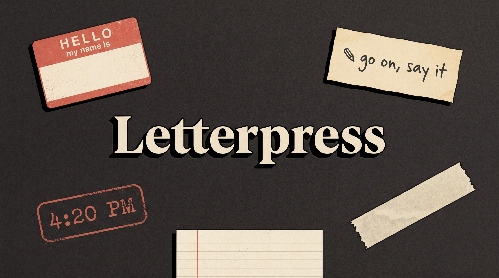

# Letterpress



A dark stationery theme for Discord: warm charcoal card stock, inked outlines, hard printed shadows and three inks (stamp red, old gold, cream).

- Buttons and reactions press into the page
- New messages get stamped on; menus and popouts drop in like paper slips
- Your user panel wears a **"HELLO my name is"** sticker
- Clicking into the message box pops up a **"✎ go on, say it"** note
- Rubber-stamp timestamps, index-card code blocks, dog-eared embeds, washi-tape member groups
- Respects Discord's and your OS's "Reduce motion" setting

Works with Vencord and BetterDiscord. Best with Discord's Dark appearance.

## Install

**Vencord (online theme):** Settings → Themes → Online Themes, and paste:

```
https://raw.githubusercontent.com/MercenaryUSA/letterpress-theme/main/Letterpress.theme.css
```

**Vencord or BetterDiscord (local):** download `Letterpress.theme.css` and drop it into your themes folder, then enable it.

## Customize

Everything is driven by the knobs at the top of the file (`:root { --lp-... }`):

| Knob | What it does |
|---|---|
| `--lp-red`, `--lp-gold`, `--lp-cream` | The three inks |
| `--lp-paper-0` … `--lp-paper-4` | Card stock, darkest to lightest |
| `--lp-grain` | Paper grain strength (`0` = smooth) |
| `--lp-nametag`, `--lp-say-it` | Set to `none` to hide a sticker |
| `--lp-nametag-text`, `--lp-say-it-text` | Change what the stickers say |

Fonts: Bricolage Grotesque, Fraunces, Caveat and Space Mono (loaded from Google Fonts).

> Discord's class names change with updates. If something stops being styled, the selectors probably need refreshing.
